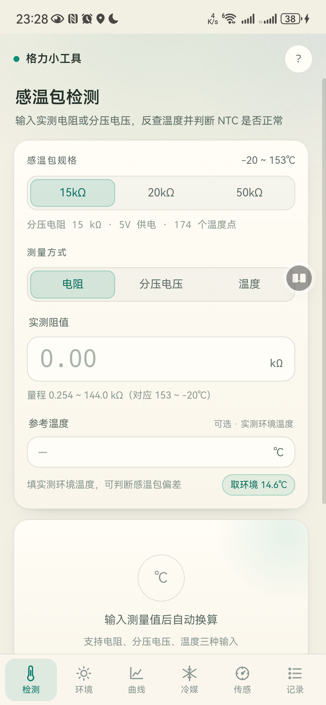
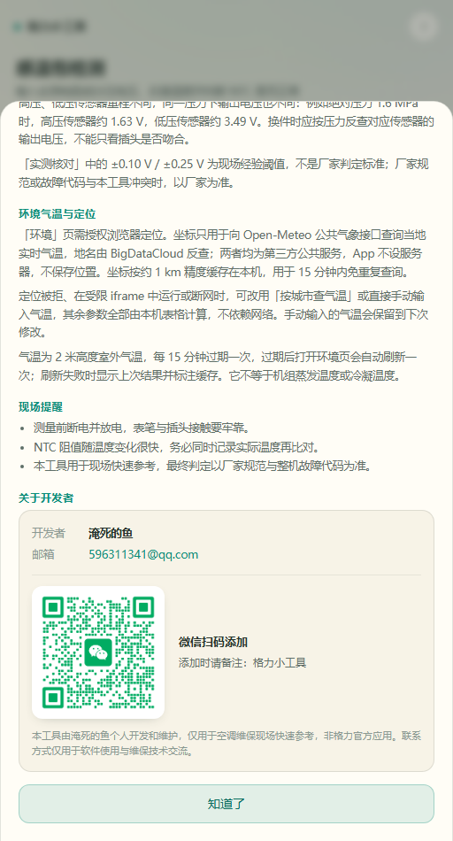

# 格力小工具

维保格力空调现场快速诊断 Android 应用，采用内置护眼主题页面。

> 本项目为个人开发的维保辅助工具，非格力官方应用。相关商标与手册权利归原权利人所有。

## 功能

- 感温包阻值、分压电压、温度互查
- 15kΩ / 20kΩ / 50kΩ 三种规格对照
- R410A、R32、R22、R134A 饱和温度与压力换算
- R410A高低压传感器电压/压力/饱和温度互查
- 环境温度定位查询（需联网）与手动输入
- 本机检测记录

## 下载

请到本仓库的 **Releases** 页面下载最新 APK：

- 最新版页面：https://github.com/596311341/gree-small-tools/releases/latest
- 直接下载：https://github.com/596311341/gree-small-tools/releases/latest/download/gree-small-tools-v1.1.1.apk

- 应用名：格力小工具
- 版本：1.1.1
- 支持 Android 7.0（API 24）及以上
- 包名：`com.hvac.eyecare`

## 截图

| 检测页 | 关于开发者 |
| --- | --- |
|  |  |

## 开发者

- 淹死的鱼
- 邮箱：596311341@qq.com
- 微信：打开 App 右上角“?”→“关于开发者”，扫码添加

## 联网与权限

- 核心检测与换算逻辑全部内置，断网可用。
- “环境”页获取实时天气需要联网，并使用定位权限；拒绝定位后可手动输入城市或温度。
- 检测记录保存在手机本机 WebView 存储中，不上传服务器。

## 构建

环境要求：JDK 17+、Android SDK 36、Gradle Wrapper。

```bash
./gradlew assembleDebug
```

Debug APK 输出：

```text
app/build/outputs/apk/debug/app-debug.apk
```

### 签名 Release

1. 复制 `keystore.properties.example` 为 `keystore.properties`。
2. 把自己的 keystore 放到 `keystore/`，并填写密码与别名。
3. 执行：

```bash
./gradlew assembleRelease
```

`keystore.properties` 和 `*.jks` 已在 `.gitignore` 中排除，不会提交到仓库。

## 目录

```text
app/src/main/assets/index.html   内置页面
app/src/main/java/...            Android WebView 外壳
screenshots/                     界面截图
```

## 说明

本工具用于现场快速参考，最终判定以厂家规范、整机故障代码和现场实测为准。使用前请断电并放电，注意作业安全。